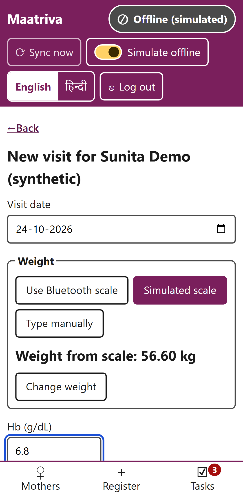
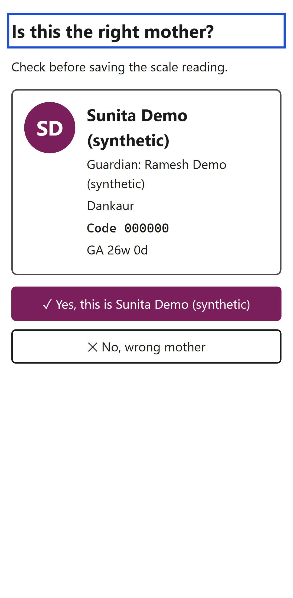
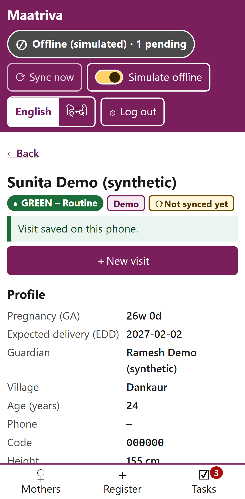
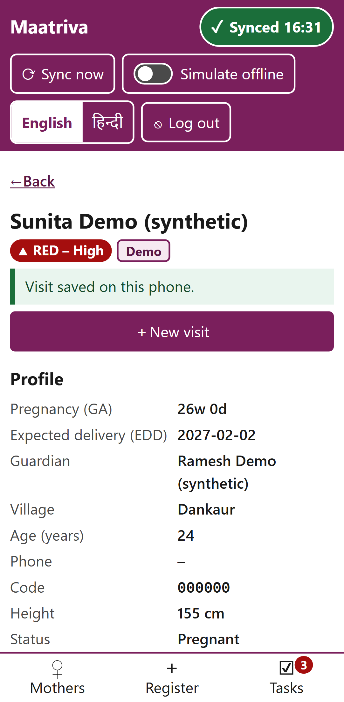
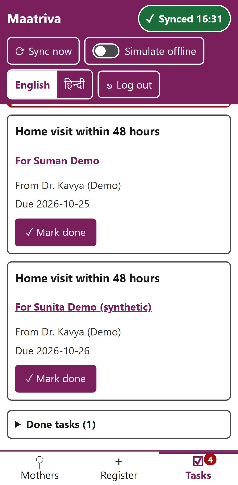
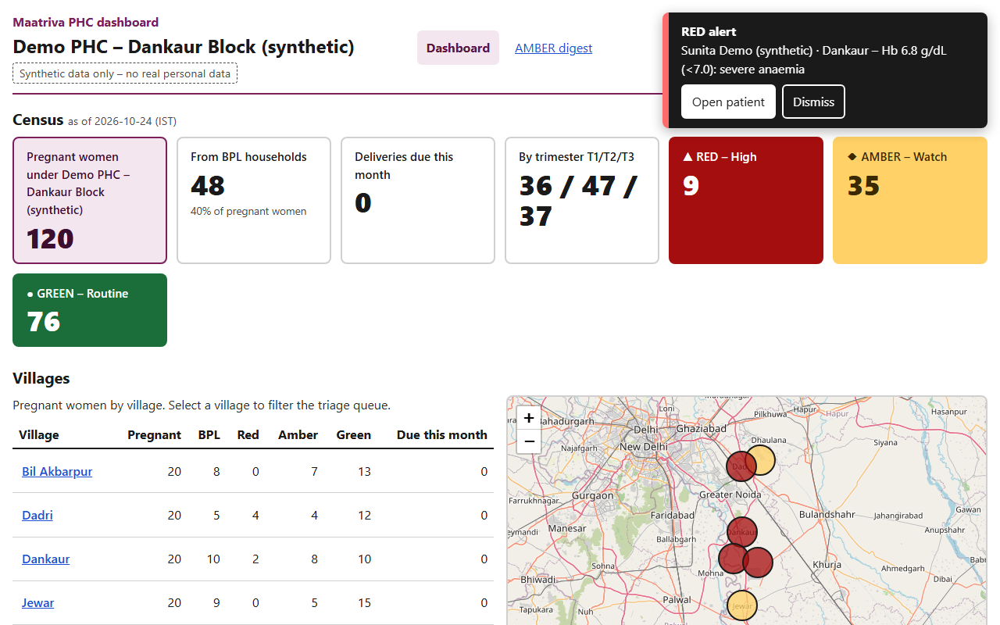
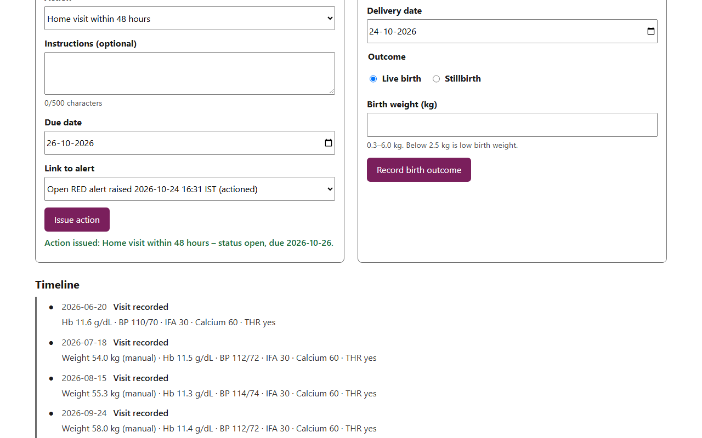
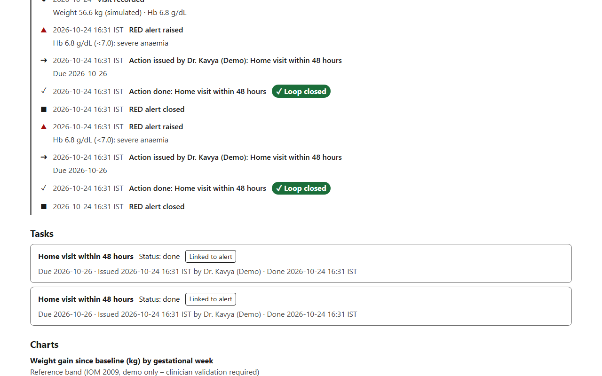
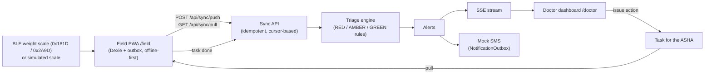

<h1 align="center">Maatriva</h1>

<p align="center"><b>Offline-first, doctor-in-the-loop maternal nutrition monitoring for rural India.</b></p>

<p align="center">
  
  
  
  
  
</p>

An ASHA worker records an antenatal visit on her phone, with a Bluetooth (or simulated) weight scale and an Hb reading, even with no network. When the phone syncs, rule-based triage flags risk. A RED case raises a live alert for the PHC Medical Officer, who issues an action. The action lands on the ASHA's phone as a task, and when she marks it done, the doctor's timeline shows the loop as closed.

> **Synthetic data only &ndash; no real personal data.** Built for the SEVA First Innovation Challenge 2026.

## Demo video

<p align="center">
  <a href="https://youtu.be/ngMUJu7p0KI" title="Watch the Maatriva demo on YouTube">
    
  </a>
  <br>
  <a href="https://youtu.be/ngMUJu7p0KI"><b>Watch the demo on YouTube</b></a>
</p>

## Why

NFHS-5 (2019&ndash;21): 52.2% of pregnant women aged 15&ndash;49 are anaemic; 35.5% of children under 5 are stunted.

ASHA workers already visit pregnant women, but readings often stay in paper registers, so a dangerous Hb value or weight loss can go unseen by a doctor for weeks. Maatriva is built around the response, not just data collection: every RED flag reaches a doctor, and every doctor action becomes a tracked task.

## Highlights

- **Closed loop, end to end:** visit, triage, live RED alert, doctor action, ASHA task, "Loop closed".
- **Works offline:** visits are saved on the phone with a visible "pending" badge and sync when the network returns. Repeated syncs are idempotent.
- **Standard Bluetooth protocol:** reads the Bluetooth SIG Weight Measurement characteristic (0x2A9D). The simulated scale emits the same bytes as a real scale.
- **Explained alerts:** reasons in plain words, for example "Hb 6.8 g/dL (&lt;7.0): severe anaemia".
- **Doctor in the loop:** the software only flags; the PHC doctor decides the action.
- **Wrong-mother protection:** a confirmation step before every save.
- **Built for the field:** Hindi and English field app, runs in the phone browser, risk shown as text and colour.
- **Role-based scoping:** each ASHA sees only her own villages.
- **Tested:** 239 backend and 292 web automated tests, plus a Playwright test that replays the whole demo loop.

## Screenshots

These are captured automatically by the Playwright end-to-end test (`web/e2e/demo-loop.spec.ts`).

### Field app (ASHA, phone)

<table>
  <tr>
    <td align="center"><br><sub>1. Offline visit: 56.6 kg, Hb 6.8</sub></td>
    <td align="center"><br><sub>2. Confirm the mother</sub></td>
    <td align="center"><br><sub>3. Saved offline: 1 pending</sub></td>
    <td align="center"><br><sub>4. Back online: Synced</sub></td>
    <td align="center"><br><sub>7. Doctor's task arrives</sub></td>
  </tr>
</table>

### Doctor dashboard (PHC Medical Officer, desktop)

<table>
  <tr>
    <td align="center"><br><sub>5. Live RED alert</sub></td>
    <td align="center"><br><sub>6. Action issued</sub></td>
  </tr>
  <tr>
    <td align="center" colspan="2"><br><sub>8. Loop closed on the timeline</sub></td>
  </tr>
</table>
## Architecture



- `backend/`: FastAPI on Python 3.10, SQLAlchemy 2, Pydantic v2, SQLite (swappable via `DATABASE_URL`). Serves `127.0.0.1:8000`.
- `web/`: one React 19 + TypeScript + Vite 6 app with two role areas:
  - `/field`: the ASHA PWA (English and Hindi), offline-first on Dexie with an outbox.
  - `/doctor`: the PHC dashboard. Doctors get live updates over SSE (consumed with `fetch` so the token goes in the `Authorization` header). ANMs get a read-only view that polls every 30 s.
- Vite serves the app on `5173` (dev) and `4173` (`npm run preview`) and proxies `/api` to the backend, so the browser only talks to Vite.

## Run on Windows

Prerequisites: Python 3.10+ (the `py` launcher is used when present) and Node.js with npm.

### One command

```powershell
powershell -ExecutionPolicy Bypass -File .\start.ps1
```

The default execution policy blocks unsigned local scripts, hence `-ExecutionPolicy Bypass`. The script:

1. Resolves Python (`py -3.10`, else `python`) and aborts below 3.10.
2. Creates `backend\.venv` if missing and installs `requirements.txt` with `requirements.lock` as constraints whenever their hash changes.
3. Seeds the database with `python -m app.seed --if-empty`.
4. Runs `npm ci` in `web` if `node_modules` is missing.
5. Opens one window for uvicorn on `127.0.0.1:8000` with `MAATRIVA_DEMO=1`, and one for the Vite dev server.
6. Prints the URLs and demo credentials.

Switches:

- `-Lan`: exposes only the Vite server on the LAN (`vite --host`). The backend stays on `127.0.0.1`. See the secure-context notes below.
- `-Reset`: reseeds with `python -m app.seed --reset` instead of `--if-empty`.

Stop the servers with Ctrl+C in their windows, or close them. Then open:

- Field app: http://127.0.0.1:5173/field
- Doctor dashboard: http://127.0.0.1:5173/doctor
- API docs: http://127.0.0.1:8000/docs

### Manual commands

Backend (first terminal):

```powershell
cd backend
py -3.10 -m venv .venv
.venv\Scripts\python -m pip install -r requirements.txt -c requirements.lock
.venv\Scripts\python -m app.seed --if-empty
$env:MAATRIVA_DEMO = "1"
.venv\Scripts\python -m uvicorn app.main:app --host 127.0.0.1 --port 8000
```

Web (second terminal):

```powershell
cd web
npm ci
npm run dev
```

Run uvicorn with a single worker (the default). The SSE event broker is in-process.

### Seed

`python -m app.seed` (run in `backend`) creates the facility "Demo PHC – Dankaur Block (synthetic)" with six villages, the demo users, 120 active mothers and 10 delivered mothers with birth outcomes. The data is deterministic.

- No flag: exits with a message if data already exists.
- `--if-empty`: seeds only when the database is empty.
- `--reset`: drops and recreates the tables (and a new sync epoch, so field devices resync from scratch), then seeds.

### Configuration

| Variable | Default | Purpose |
|---|---|---|
| `DATABASE_URL` | `sqlite:///backend/maatriva.db` | SQLAlchemy URL |
| `MAATRIVA_JWT_SECRET` | generated into `backend/.secrets/jwt_secret` | JWT signing secret |
| `MAATRIVA_DEMO` | `0` | `1` enables `/api/demo/*` (404 otherwise) |
| `MAATRIVA_TRIAGE_INTERVAL_S` | `900` | Periodic re-triage interval |
| `MAATRIVA_SEED_TODAY` | IST today | Seed day, `YYYY-MM-DD` (used by the seed only) |
| `MAATRIVA_TOKEN_TTL_FIELD_H` / `_STAFF_H` | `168` / `12` | Token lifetimes in hours |

### Demo credentials

All passwords are `demo1234`.

| Username | Role | Area | Villages |
|---|---|---|---|
| `doctor1` | PHC Medical Officer | `/doctor` | whole facility |
| `anm1` | ANM (read-only, digest) | `/doctor` | whole facility |
| `asha1` | ASHA | `/field` | Dankaur, Dadri |
| `asha2` | ASHA | `/field` | Bil Akbarpur, Jhajhar |
| `asha3` | ASHA | `/field` | Rabupura, Jewar |
| `admin1` | Admin | `/admin` (placeholder) | none; can call the demo endpoints |

### Demo-day reset

The demo mother, "Sunita Demo (synthetic)" (village Dankaur, ASHA `asha1`), is GREEN on the seed day with a last visit 30 days earlier. A few days later she turns AMBER with `VISIT_OVERDUE`, so reset her on demo day. Either option works:

- With the backend running: `powershell -ExecutionPolicy Bypass -File .\scripts\trigger-red.ps1 -Reset`, which calls `POST /api/demo/reset`. This re-dates her history relative to today and closes her alerts and tasks.
- Full reseed: stop the servers, then run `.\start.ps1 -Reset` (or `python -m app.seed --reset` in `backend`).

## 5-minute demo script

Preparation: reset the demo mother (see above). Open the doctor dashboard as `doctor1` in a desktop window. Open the field app as `asha1` in a phone-sized window (for example, Chrome DevTools device mode) and wait for the badge to show "Synced".

1. Field: turn on "Simulate offline".
2. Open "Sunita Demo (synthetic)", then New visit.
3. Simulated scale: press "Demo preset (56.6 kg)", then "Step on scale", then "Use this reading".
4. Enter Hb 6.8 and save. Confirm "Yes, this is Sunita Demo (synthetic)".
5. The badge shows "1 pending". The visit is stored only on the phone.
6. Turn "Simulate offline" off. The badge shows "Synced".
7. Doctor: a RED toast appears within seconds (`HB_SEVERE` and `WEIGHT_LOSS`). A mock SMS row is written for the doctor.
8. Open the patient and issue "Home visit within 48 hours".
9. Field: after sync, the task appears in the Tasks inbox. Press "Mark done".
10. Doctor: the patient timeline shows "Loop closed".

Backup if the field flow stalls: with the backend running, trigger the RED alert directly.

```powershell
powershell -ExecutionPolicy Bypass -File .\scripts\trigger-red.ps1
```

It logs in and calls `POST /api/demo/trigger-red`, which records a demo visit (last weight minus 1.4 kg, Hb 6.8) and runs triage. Parameters:

- `-BaseUrl` (default `http://127.0.0.1:8000`)
- `-Username` (default `doctor1`; `admin1` also works)
- `-Password` (default `demo1234`)
- `-Reset`: calls `POST /api/demo/reset` instead

The backend must run with `MAATRIVA_DEMO=1`. `start.ps1` sets it.

## Tests

```powershell
cd backend; .venv\Scripts\python -m pytest
cd web; npm test; npm run build
```

Backend property tests use the in-repo seeded helper `backend/tests/pbt.py`. Hypothesis is not used because the backend dependency list is fixed. Web property tests use `fast-check`.

### End-to-end (Playwright)

```powershell
cd web
npx playwright install chromium
npm run e2e
```

The script `web/e2e/demo-loop.spec.ts` drives the whole loop in two browser contexts: `asha1` on a Pixel 7 profile and `doctor1` on desktop. It starts with `POST /api/demo/reset`, so it can run repeatedly. Playwright starts the backend (with `MAATRIVA_DEMO=1`, seeding with `--if-empty` first) and Vite, or reuses servers that are already running. A reused backend must already run with `MAATRIVA_DEMO=1`, which `start.ps1` handles. Each step is named, so a timeout reports the failing step.

Screenshots go to `docs/screenshots/`:

- `04-offline-visit.png`
- `05-confirm-mother.png`
- `06-one-pending.png`
- `08-synced.png`
- `09-doctor-red-toast.png`
- `10-action-issued.png`
- `11-asha-task.png`
- `13-loop-closed.png`

## Bluetooth scale and secure context

- A real scale needs Chrome on desktop or Android, a scale that implements the Bluetooth Weight Scale Service (0x181D, Weight Measurement 0x2A9D), and a secure context.
- `http://localhost` and `http://127.0.0.1` count as secure. A LAN IP over plain HTTP (for example, a phone opening `http://192.168.x.x:5173` via `-Lan`) does not, so Web Bluetooth is unavailable there.
- For real-scale testing over the LAN, serve HTTPS (a dev certificate or a tunnel), or use Chrome's "Insecure origins treated as secure" flag on a test device.
- A plain-HTTP LAN origin also disables:
  - the service worker, so the app cannot reload offline
  - Web Locks (an in-module lock is used instead)
  - `crypto.randomUUID` (a `getRandomValues` fallback is used)
- The simulated scale works everywhere. It encodes a real 0x2A9D payload and decodes it with the same parser.

## Accessibility

Risk is always shown as an icon, a text word and a colour, never colour alone. Every input has a label, focus outlines are visible, and the doctor dashboard is keyboard navigable (filters, then queue, then panels). Full WCAG conformance requires manual testing with assistive technologies and an expert accessibility review, which has not been done.

## Limitations

- Triage thresholds are demo values and need clinician validation.
- Mother edits use last-write-wins on the client clock.
- SSE is single-process. Run one uvicorn worker.
- List endpoints have no paging.
- The session token is stored in `localStorage`.
- There is no rate limiting.
- The database is SQLite.
- Reassigning a village to another ASHA does not back-fill her mothers onto the new ASHA's device.
- A mother moved to a village outside a co-ASHA's scope stays stale on that ASHA's device. Pulls carry no deletes, and a village change does not rotate the sync epoch.
- `MAATRIVA_SEED_TODAY` affects only the seed. Runtime code uses the real clock.

## Production needs

Before any real use, the system needs:

- ABDM/ABHA identity integration
- explicit consent capture
- encryption at rest, on the server and on the device
- audit logging of record access
- secrets management in place of the generated dev JWT secret
- HTTPS everywhere
- stronger token storage, rate limiting and paging
- a multi-process event bus for SSE
- backups
- a clinical safety review of the triage rules

## Roadmap

- Native app
- ABDM/ABHA integration
- PostgreSQL/PostGIS
- Real SMS gateway (the MVP writes mock SMS rows only)
- Hb device integration
- Clinician-validated rules
- Database migrations
- Out of MVP scope:
  - BLE blood-pressure parser (0x2A35, SFLOAT) and a simulated cuff
  - Admin district census (`/api/admin/census` and an `/admin` page; `/admin` is a placeholder today)
  - Hindi in the doctor area (the field area already has it)

## Dependency pins

Every dependency is pinned to an exact version: `backend/requirements.txt` plus `backend/requirements.lock`, and `web/package.json` plus `package-lock.json`. All pinned versions installed as specified. No substitutions were needed: the backend venv matches `requirements.txt` on Python 3.10.4, and `web/node_modules` matches `package.json`.
